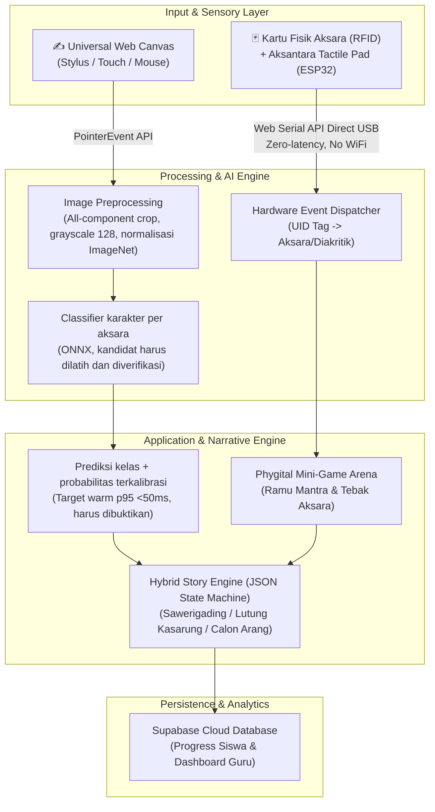

# 🇮🇩 Aksantara (Aksara Nusantara)
### Multi-Modal AI Classifier & Phygital Platform Pelestarian Aksara Nusantara
> **Kompetisi:** Hackathon JOINTS UGM 2026 - **Tema:** Education  
> **Fokus Wilayah:** Trinitas Aksara Nusantara (Lontara, Sunda, Bali)  
> **Status:** Active Development | Target Final: FMIPA Universitas Gadjah Mada (1 November 2026)

---

## 📌 Ringkasan Eksekutif

Indonesia memiliki lebih dari 700 bahasa daerah dan puluhan aksara tradisional, namun generasi muda menghadapi krisis literasi aksara non-Latin akibat metode pengajaran konvensional yang monoton, ketiadaan media peraga interaktif di ruang kelas, dan kejenuhan layar gawai (*screen fatigue*).

**Aksantara** hadir sebagai platform edukasi multi-modal yang menjembatani pelestarian budaya melalui pendekatan **Phygital (Physical + Digital)**:
1. **Web Mode (Digital AI):** Latihan menulis bebas pada *Universal Web Canvas* (stylus, touchscreen, mouse), dengan eksperimen classifier citra karakter Lontara/Sunda/Bali tanpa penalti urutan goresan. Klasifikasi kelas bukan verifikasi posisi diakritik; mapping Unicode dan kelayakan pedagogis memerlukan kurasi.
2. **Hardware Mode (Phygital IoT):** Pembelajaran motorik sensorik anak melalui konsol fisik **Aksantara Tactile Pad** (ESP32 + RFID Reader) menggunakan kartu fisik akrilik ber-tag RFID yang tersambung instan via **Web Serial API (USB Plug-and-Play)** langsung ke browser dengan *zero-latency* dan *zero-dependency* terhadap jaringan WiFi panggung demo.
3. **Narrative Story Mode:** Gamifikasi cerita rakyat interaktif (*Sawerigading, Lutung Kasarung, Calon Arang*) dengan percabangan cerita deterministik.
4. **Preservasi Manuskrip Kuno:** Modul *Human-in-the-Loop* untuk koreksi dan transliterasi digital naskah lontar kuno.

---

## 🏛️ Trinitas Aksara Nusantara (Scope Terkunci)

Aksantara mengonsolidasikan fokus implementasi pada 3 aksara Nusantara dengan karakter paleografi kontras:

| Aksara | Karakteristik Visual | Representasi Geografis & Budaya | Nilai Teknis AI Classifier |
|---|---|---|---|
| **Lontara** | Sudut tajam, garis lurus, dominan geometris | Sulawesi Selatan (Bugis-Makassar) | Evaluasi ketajaman sudut dan proporsi garis lurus binarisasi |
| **Sunda** | Pola konsonan *ngalagena* modular dengan tanda *rarangken* | Jawa Barat (Pasundan) | Evaluasi konsistensi modular dan letak diakritik (atas, bawah, samping) |
| **Bali** | Kurvalinier dinamis, lengkung kontinu, ligatur gantungan (*adeg-adeg*) | Bali & Nusa Tenggara | Uji stres model pada kurva halus dinamis dan ligatur kompleks |

---

## 🏗️ Arsitektur Sistem (System Architecture)



---

## 📂 Struktur Repositori (Monorepo Structure)

Repositori ini diatur dengan arsitektur modular yang memisahkan ranah tanggung jawab tim secara bersih:

```
aksantara/
├── .agent/                    # Konfigurasi AI agent rules (Next.js 16, Anti-Slop, Ponytail)
├── context/                   # Dokumentasi resmi & SSOT (AKSANTARA-SSOT-v3.1.md)
├── web/                       # Aplikasi Web Frontend (Next.js 16 App Router + Tailwind v4)
├── ai/                        # Eksperimen classifier karakter, harness canvas & ekspor ONNX
├── iot/                       # Firmware mikrokontroler ESP32 + skema Aksantara Tactile Pad
├── .gitignore                 # Filter proteksi monorepo (Node, Python, ESP32, Secrets)
└── README.md                  # Dokumentasi utama proyek
```

SSOT resmi berada di [`context/AKSANTARA-SSOT-v3.1.md`](context/AKSANTARA-SSOT-v3.1.md); panduan kompetisi berada di [`context/competition/guidebook-joints-2026.md`](context/competition/guidebook-joints-2026.md).

Folder `datasets/` disimpan lokal dan tidak diikutkan ke Git. Konfigurasi asisten lokal `.agents/` dan `.omp/` juga di-ignore; aturan tim yang dilacak berada di `.agent/`.

Branch `main` mengikuti struktur dasar monorepo. Implementasi frontend yang sudah tersedia di remote berada pada branch `web`.

### Kaggle MCP untuk Training

Konfigurasi lokal OMP berada di `.omp/mcp.json` (di-ignore Git):

```json
{
  "mcpServers": {
    "kaggle": {
      "type": "http",
      "url": "https://www.kaggle.com/mcp"
    }
  }
}
```

Setelah menambahkan konfigurasi, jalankan `/mcp reload`, lalu `/mcp test kaggle` di OMP. Gunakan `/mcp reauth kaggle` untuk memulai autentikasi OAuth melalui browser; dukungan alur autentikasi perlu diverifikasi pada akun yang digunakan. Jangan menyimpan token di repository atau membagikannya lewat chat.

Handshake dan discovery tool dapat berhasil tanpa autentikasi; ini bukan bukti izin menjalankan training atau ketersediaan GPU. Periksa autentikasi dan kuota akun sebelum memulai job. Referensi: [Kaggle MCP resmi](https://www.kaggle.com/docs/mcp).

#### Eksekusi pipeline classifier

Jalankan dari root repo dengan environment Python yang sesuai `ai/requirements.txt`:

```sh
python ai/runner.py audit --out ai/runs/audit
python ai/runner.py split --out ai/runs/splits
python ai/runner.py preprocess-check --out ai/runs/preprocess-check
python ai/runner.py setup-runtime
python ai/runner.py serve --port 8765
python ai/runner.py report --out ai/runs/comparison
```

Buka `http://127.0.0.1:8765/harness/` untuk koleksi, parity Python/JS, dan benchmark kandidat nyata. Koleksi tidak menampilkan skor model. Simpan PNG 512×512 dan JSON dengan stem sama di `datasets/canvas_capture/`, lalu `audit --canvas-root datasets/canvas_capture --out <audit-baru>`. Writer harus tetap pada satu partition; consent training/research wajib, consent private upload terpisah. Tulisan hasil otomasi/font tidak boleh menjadi holdout manusia.

Kode `.py` adalah sumber modular. `build-notebook --script lontara --model mobile --smoke --epochs 2` mengemas kode/config/label/split ke **satu `.ipynb` self-contained per job** di `ai/notebooks/`; VM Kaggle tidak membutuhkan checkout repo. Builder memblokir izin/split yang belum siap. Smoke tidak menyelesaikan screening. Notebook Kaggle harus private, GPU gratis, satu job aktif, timeout maksimal satu jam; checkpoint/resume menjaga hash data dan konfigurasi.

Model didukung: `cnn`, `mobile`, `efficient`, `hybrid`, `mobile-scratch`, `resnet18`, `resnet18-scratch`. Training memakai `train --script <aksara> --model <model> --out <run>`, dengan `--pilot --loss ordinary|weighted` hanya untuk pilot imbalance yang diperlukan; `--size 224` untuk ablation; `--stage canvas|distill --initialize <best.pt>` untuk stage lanjutan. Distillation juga memerlukan `--teacher <ensemble.json>`. Screening, seed reruns, ensemble, calibration, ekspor dan test tetap mengikuti [training plan](docs/plans/01_aksantara_training_plan.md); tidak memilih model dari test.

#### Notebook Interaktif Modular (Jupyter & Colab)

Panduan untuk penerima handoff: **[Model AI Terpilih, Hasil Evaluasi, dan Integrasi Canvas](docs/AI_MODEL_HANDOFF.md)** — sumber artefak aktif, metrik selection, kontrak backend, cara menjalankan lokal, dan batas klaim.

Tersedia 4 notebook modular interaktif di `ai/notebooks/` untuk inspeksi langsung, visualisasi data paleografi, dan evaluasi diagnostik:
- [`01_sunda_classifier.ipynb`](ai/notebooks/01_sunda_classifier.ipynb): 30 kelas, champion EfficientNet-B0, selection Macro-F1 **100.00%** (180 sampel).
- [`02_lontara_classifier.ipynb`](ai/notebooks/02_lontara_classifier.ipynb): 114 kelas, champion ResNet-18, selection Macro-F1 **99.82%** (990 sampel).
- [`03_bali_classifier.ipynb`](ai/notebooks/03_bali_classifier.ipynb): 30 kelas, champion EfficientNet-B0, selection Macro-F1 **99.37%** (167 sampel).
- [`04_combined_174_classifier.ipynb`](ai/notebooks/04_combined_174_classifier.ipynb): 174 kelas, champion ResNet-18, selection Macro-F1 **99.83%** (1,337 sampel).

Notebook memakai maksimum 50 epoch, early stopping patience 7 berdasarkan selection Macro-F1, pemulihan checkpoint terbaik, history aktual, dan ekspor FP32/INT8. Sel akhir refresh perbandingan membaca hasil tersimpan tanpa training ulang. Skor selection bukan frozen test atau bukti generalisasi tulisan canvas.

Artefak generated berada di ignored `ai/runs/`, `ai/artifacts/`, `ai/notebooks/`. `report` mencatat pending/blocked/observed runs, bukan membuat metrics yang belum ada. Frozen labels berjumlah 114/30/30, termasuk `Ke`/`Ke_` dan `ae`/`e`; semuanya belum merupakan mapping Unicode terverifikasi.

Tiga kandidat spesialis FP32 tersedia di `ai/deployment/models/<script>/model.onnx`, dengan urutan `labels.json`, kontrak preprocessing dan SHA-256 di `manifest.json`, serta hasil run di `evaluation.json`. Input adalah float32 NCHW `[N, 3, 128, 128]`, grayscale canonical yang dinormalisasi ImageNet. Bobot dipakai untuk eksperimen privat; izin publikasi, kalibrasi, mapping Unicode, kualitas tulisan manusia dan benchmark browser belum disahkan. Combined/INT8 tetap di artefak eksperimen ignored.

Backend privat menjalankan ketiga spesialis melalui ONNX Runtime CPU dengan session yang di-cache dan kontrak model diverifikasi saat startup:

```bash
# Dari root repository, environment Python terpisah dari training.
python -m pip install -r ai/deployment/requirements.txt
python -m uvicorn ai.deployment.server:app --host 127.0.0.1 --port 8000

# Terminal kedua:
npm --prefix web ci
npm --prefix web run dev
```

`GET http://127.0.0.1:8000/health` melaporkan kesiapan model. Web meneruskan PNG melalui `POST /api/ai/classify` ke `POST /predict`; `AI_CLASSIFIER_URL` adalah konfigurasi **server-only**, default `http://127.0.0.1:8000`. Inference mengabaikan urutan goresan dan memakai preprocessing canonical di backend. UI menampilkan Top-3 label sumber/probabilitas, status perlu review dan target yang belum didukung; tidak ada fallback skor acak atau pemberian XP/penguasaan dari probabilitas eksperimen. Kanvas kosong atau citra invalid ditolak; service offline menghasilkan error 503 yang terlihat.

Jika web di-host terpisah, backend Python juga harus dijalankan di host yang dapat dijangkau web dan `AI_CLASSIFIER_URL` diatur sesuai alamatnya. Integrasi lokal ini bukan izin publikasi model atau bukti latensi browser/WASM memenuhi anggaran.

Studi Colab empat classifier (tiga specialist + satu gabungan 174 kelas) memakai **satu ZIP runtime terpisah** dari dataset. Dari root repo jalankan `python ai/colab_notebook.py`, lalu upload `ai/notebooks/aksantara-colab-runtime.zip` ke folder Google Drive `Colab Notebooks/dataset-joints-1/` bersama `canvas_classifier.zip` yang teramati di Drive. Buka notebook Drive Aksantara yang sudah digunakan: notebook memuat pengantar Markdown, lima cell kode konfigurasi/bootstrap/dataset/preflight/launch, dan satu cell Progress yang bisa dijalankan ulang. Pastikan GPU dan otorisasi Drive berhasil. ZIP runtime dipin SHA256 oleh cell konfigurasi; jangan jalankan cell dari build yang berbeda dengan ZIP yang diupload. Jika mount gagal, selesaikan dialog izin Drive lalu ulangi cell setup; jika modul `ai.*` dari bundle berbeda sudah diimport, restart runtime dan ulangi dari cell pertama.

`ai.colab_experiments.preflight(DATA_ROOT)` memverifikasi byte source dan split asli; `launch(DATA_ROOT, SAVE_ROOT, RUNTIME_SHA256)` memulai **satu worker background**, bukan training selesai. Jalankan ulang cell **Progress** untuk snapshot status serta delapan epoch terakhir; tidak ada polling otomatis atau log besar di browser. Tujuh treatment berurutan: Sunda ordinary; Lontara, Bali, dan gabungan masing-masing ordinary/weighted. Snapshot checksum disimpan per attempt di Drive; worker memulihkan attempt published saat VM baru memakai identitas runtime/data/recipe yang sama. Status `completed` hanya setelah empat checkpoint lengkap dan `comparison.json` tersedia. Perbandingan selection bersifat provisional: baseline specialist memakai *script-known routing*, gabungan memprediksi 174 kelas tanpa informasi aksara; bukan skor test/handwriting atau izin release.

Gate sumber terdokumentasi di `ai/configs/provenance.json`: Lontara hanya untuk riset nonkomersial private menurut CC BY-NC-ND §2(a)(1)(B), release unresolved; Sunda/Bali training dan release unresolved. Data pengganti tulisan sendiri memerlukan bukti consent dan provenance `own_data`; jangan upload ulang sumber ambigu. Koleksi minimum per aksara: 10 writer × 2 tulisan per kelas, partition writer 4/2/2/2 untuk train/selection/calibration/test.

Paket ONNX tidak dianggap siap hanya karena file berhasil diekspor. Wajib parity, benchmark browser WASM offline 20+200, warm end-to-end p95 <50ms, ≤15MiB per aksara aktif, frozen test dan izin release; confidence kelas bukan nilai kualitas tulisan. NusaAksara tetap sumber **citra baris/OCR**, bukan checkpoint pretrained atau karakter tersegmentasi. MobileNet/EfficientNet pretrained memakai ImageNet.


---

## ⚡ Tech Stack

- **Web Frontend:** Next.js 16.x (App Router), React 19.x, Tailwind CSS v4.x, Lucide Icons
- **Hardware & IoT:** ESP32 Microcontroller, RFID Reader RC522 (13.56 MHz), Web Serial API (USB Direct)
- **AI & Computer Vision:** Eksperimen classifier karakter CNN/MobileNet/EfficientNet/hybrid attention, pretraining ImageNet; ONNX Runtime Web lokal. NusaAksara (ACL 2025) untuk citra baris/OCR, bukan training karakter tanpa anotasi segmentasi.
- **Backend & Database:** Supabase (PostgreSQL), Deterministic JSON Story Graph
- **Deployment:** Vercel (HTTPS aktif untuk akses Web Serial API)

---

## 📖 Atribusi & Sitasi Akademis

Sumber karakter Kaggle dan hak penggunaannya dicatat di `ai/configs/provenance.json`; benchmark manuskrip dan tipografi dirujuk terpisah:
- **NusaAksara:** *A Benchmark for Multi-Script Indic-Indonesian Languages*, Association for Computational Linguistics (ACL 2025). Peneliti: Mohamed bin Zayed University of Artificial Intelligence (MBZUAI) & Monash University Indonesia.
- **Tipografi Aksara:** Google Noto Sans Fonts (`Noto Sans Buginese`, `Noto Sans Sundanese`, `Noto Sans Balinese`).

---

## 👥 Tim Pengembang (JOINTS UGM 2026)
Dikembangkan dengan dedikasi penuh untuk pelestarian kekayaan budaya Nusantara di era digital dan fisik.
