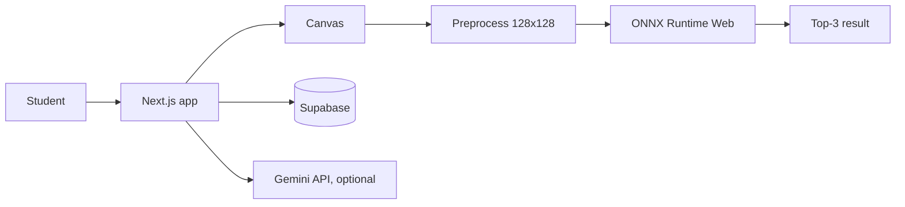

# Aksantara — Aksara Bali Writing Coach

Web app where students write Aksara Bali on a canvas and an AI model classifies the shape of what they wrote, with a curriculum and folk-story mode around it. Built for **Bali DigiFest 2026 — AI Web Innovation Challenge** ("Build With AI, Solve For Bali"). Aksantara is a pre-existing project; see [`docs/DISCLOSURE.md`](docs/DISCLOSURE.md).

> Status: active development. Which features are real and which are still placeholders is tracked in [`docs/CONTEXT.md`](docs/CONTEXT.md) and [`docs/MIGRATION.md`](docs/MIGRATION.md).

## Problem and users
Aksara Bali is still used on signage, in ceremonies and in local-content (muatan lokal) lessons, but practice is mostly rote copying from books with no feedback on a student's own handwriting. Target users: students learning Balinese, their teachers, and anyone curious about the script.

## Features
Only what works today is listed here; items in progress are in the migration plan.
- **Writing practice:** draw a character on the canvas; the classifier returns top-3 predictions and whether the drawing matches the target. Stroke order does not matter.
- **Story mode:** branching folk-story chapters with writing challenges; narrator dialog from Gemini with a fixed-text fallback.
- **Manuscript preservation:** students propose Latin transliterations of manuscript images; teachers/curators review them.
- **Accounts:** Supabase auth with student and reviewer roles.

## AI implementation
EfficientNet-B0 (ImageNet-pretrained, fine-tuned) exported to ONNX and run in the browser with ONNX Runtime Web. Input: 128×128 grayscale canvas snapshot. Output: probabilities over 30 classes (18 *wyajana*, 12 *swalalita*). Details and limits (selection-set metrics, uncalibrated probabilities): [`docs/AI_MODEL.md`](docs/AI_MODEL.md).

## Architecture


## Tech stack
Next.js 16, React 19, Tailwind CSS v4, TypeScript, Supabase, ONNX Runtime Web, Gemini API, Python (PyTorch) for training in `ai/`.

## Run locally
```bash
cd web
npm ci
npm run dev   # http://localhost:3000
```
Environment variables, database and the interim Python proxy: [`docs/SETUP.md`](docs/SETUP.md).

## Repository layout
| Path | Purpose |
|---|---|
| `web/` | Next.js app |
| `ai/` | Training, evaluation, export and canvas-collection harness |
| `supabase/` | Database schema |
| `docs/` | Context, setup, AI contract, migration plan, disclosure, usage log, contest guidebook |

For AI agents: start at [`AGENTS.md`](AGENTS.md).

## Known limitations
- Classifier covers 30 base characters; no vowel signs or conjunct forms (*pangangge*, *gantungan*).
- Reported accuracy comes from a small selection set, not from real student handwriting.
- Dataset licence is unknown; model weights are a private experiment.
- Some pages still show sample data (see the migration plan).

## Third-party resources
Kaggle `wildanfatahh22/aksara-bali`, NusaAksara (reference), Google Noto Sans Balinese, ImageNet pretrained weights, and the npm/PyPI dependencies in `web/package.json` and `ai/requirements.txt`.

## Team
`TODO`
