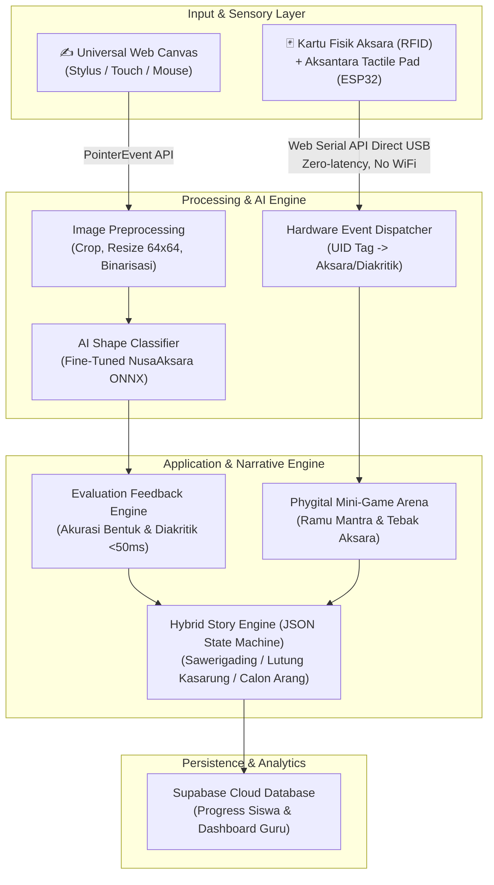

# 🇮🇩 Aksantara (Aksara Nusantara)
### Multi-Modal AI Classifier & Phygital Platform Pelestarian Aksara Nusantara
> **Kompetisi:** Hackathon JOINTS UGM 2026 - **Tema:** Education  
> **Fokus Wilayah:** Trinitas Aksara Nusantara (Lontara, Sunda, Bali)  
> **Status:** Active Development | Target Final: FMIPA Universitas Gadjah Mada (1 November 2026)

---

## 📌 Ringkasan Eksekutif

Indonesia memiliki lebih dari 700 bahasa daerah dan puluhan aksara tradisional, namun generasi muda menghadapi krisis literasi aksara non-Latin akibat metode pengajaran konvensional yang monoton, ketiadaan media peraga interaktif di ruang kelas, dan kejenuhan layar gawai (*screen fatigue*).

**Aksantara** hadir sebagai platform edukasi multi-modal yang menjembatani pelestarian budaya melalui pendekatan **Phygital (Physical + Digital)**:
1. **Web Mode (Digital AI):** Latihan menulis bebas pada *Universal Web Canvas* (stylus, touchscreen, mouse) yang dievaluasi secara cerdas oleh model **AI Shape & Diacritic Topology Classifier** berbasis benchmark akademis **NusaAksara (ACL 2025)** tanpa bias urutan tarikan kaku (*no artificial stroke order penalty*).
2. **Hardware Mode (Phygital IoT):** Pembelajaran motorik sensorik anak melalui konsol fisik **Aksantara Tactile Pad** (ESP32 + RFID Reader) menggunakan kartu fisik akrilik ber-tag RFID yang tersambung instan via **Web Serial API (USB Plug-and-Play)** langsung ke browser dengan *zero-latency* dan *zero-dependency* terhadap jaringan WiFi panggung demo.
3. **Narrative Story Mode:** Gamifikasi cerita rakyat interaktif (*Sawerigading, Lutung Kasarung, Calon Arang*) dengan percabangan cerita deterministik.
4. **Preservasi Manuskrip Kuno:** Modul *Human-in-the-Loop* untuk koreksi dan transliterasi digital naskah lontar kuno.

---

## 🏛️ Trinitas Aksara Nusantara (Scope Terkunci)

Aksantara mengonsolidasikan fokus implementasi pada 3 aksara Nusantara dengan karakter paleografi kontras:

| Aksara | Karakteristik Visual | Representasi Geografis & Budaya | Nilai Teknis AI Classifier |
|---|---|---|---|
| **Lontara** | Sudut tajam, garis lurus, dominan geometris | Sulawesi Selatan (Bugis-Makassar) | Evaluasi ketajaman sudut dan proporsi garis lurus binarisasi |
| **Sunda** | Pola konsonan *ngalagena* modular dengan tanda *rarangken* | Jawa Barat (Pasundan) | Evaluasi konsistensi modular dan letak diakritik (atas, bawah, samping) |
| **Bali** | Kurvalinier dinamis, lengkung kontinu, ligatur gantungan (*adeg-adeg*) | Bali & Nusa Tenggara | Uji stres model pada kurva halus dinamis dan ligatur kompleks |

---

## 🏗️ Arsitektur Sistem (System Architecture)



---

## 📂 Struktur Repositori (Monorepo Structure)

Repositori ini diatur dengan arsitektur modular yang memisahkan ranah tanggung jawab tim secara bersih:

```
aksantara/
├── .agent/                    # Konfigurasi AI agent rules (Next.js 16, Anti-Slop, Ponytail)
├── context/                   # Dokumentasi resmi & SSOT (AKSANTARA-SSOT-v3.1.md)
├── web/                       # Aplikasi Web Frontend (Next.js 16 App Router + Tailwind v4)
├── ai/                        # Pipeline Machine Learning, Dataset NusaAksara & Model ONNX
├── iot/                       # Firmware mikrokontroler ESP32 + skema Aksantara Tactile Pad
├── .gitignore                 # Filter proteksi monorepo (Node, Python, ESP32, Secrets)
└── README.md                  # Dokumentasi utama proyek
```

---

## ⚡ Tech Stack

- **Web Frontend:** Next.js 16.x (App Router), React 19.x, Tailwind CSS v4.x, Lucide Icons
- **Hardware & IoT:** ESP32 Microcontroller, RFID Reader RC522 (13.56 MHz), Web Serial API (USB Direct)
- **AI & Computer Vision:** Model Klasifikasi Citra fine-tuned dari benchmark **NusaAksara (ACL 2025)**, ONNX Runtime Web
- **Backend & Database:** Supabase (PostgreSQL), Deterministic JSON Story Graph
- **Deployment:** Vercel (HTTPS aktif untuk akses Web Serial API)

---

## 📖 Atribusi & Sitasi Akademis

Fondasi model AI pada proyek ini memanfaatkan dataset dan benchmark akademis resmi:
- **NusaAksara:** *A Benchmark for Multi-Script Indic-Indonesian Languages*, Association for Computational Linguistics (ACL 2025). Peneliti: Mohamed bin Zayed University of Artificial Intelligence (MBZUAI) & Monash University Indonesia.
- **Tipografi Aksara:** Google Noto Sans Fonts (`Noto Sans Buginese`, `Noto Sans Sundanese`, `Noto Sans Balinese`).

---

## 👥 Tim Pengembang (JOINTS UGM 2026)
Dikembangkan dengan dedikasi penuh untuk pelestarian kekayaan budaya Nusantara di era digital dan fisik.
