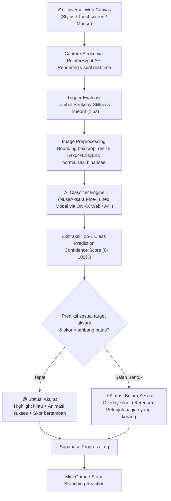
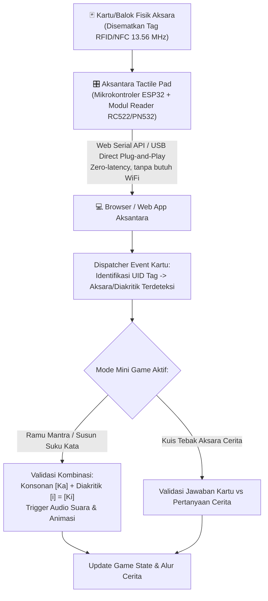
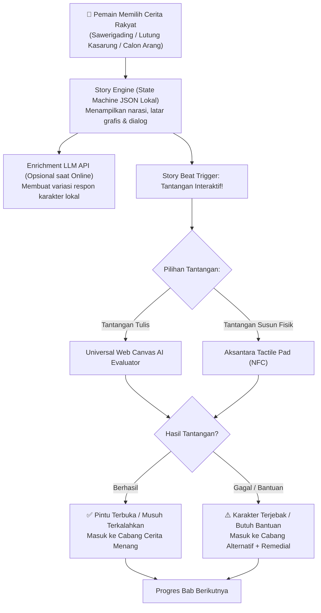
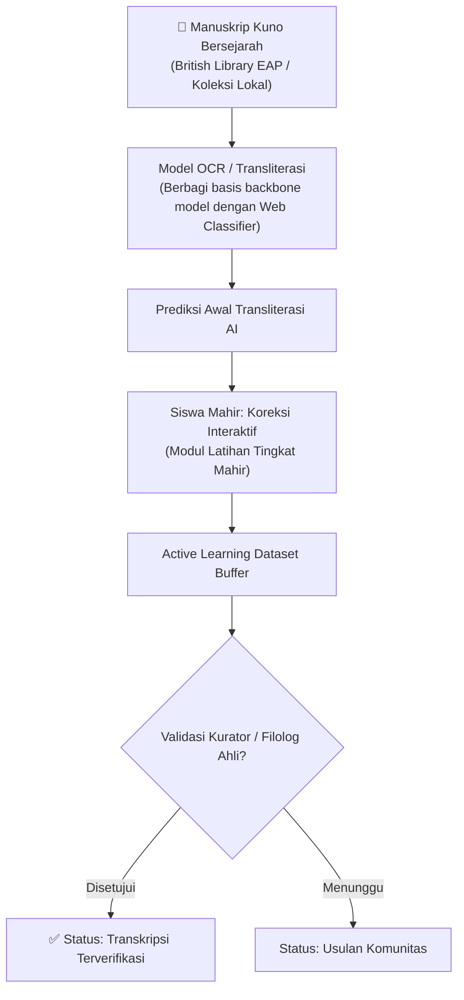
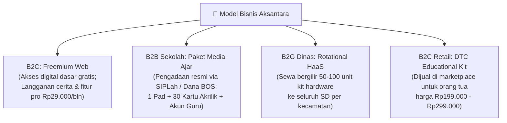
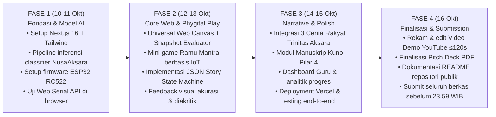

# AKSANTARA — Single Source of Truth (SSOT v3.1)
### Multi-Modal AI Classifier & Phygital Platform Pelestarian Aksara Nusantara
> **Kompetisi:** Hackathon JOINTS UGM 2026 — **Tema: Education**  
> **Status:** Versi 3.1 — penghapusan referensi fitur multiplayer yang tidak terdefinisi | Diperbarui: 10 Oktober 2026  
> **Sifat Dokumen:** **Satu-satunya rujukan resmi tim.** Scope penuh: 4 Pilar × 2 Mode + Gamified Narrative & Tangible IoT Layer, dikonsolidasi penuh pada **Trinitas Aksara Nusantara (Lontara, Sunda, Bali)**. Prioritas utama: kesesuaian arsitektur-dataset-algoritma, validasi teknis/akademis, unifikasi dataset, dan konsistensi klaim vs kode (Bagian 12).

---

## 0. Ringkasan Eksekutif & Filosofi Nama

| Parameter | Spesifikasi |
|---|---|
| **Nama Proyek** | **Aksantara** *(Aksara Nusantara Berdaya di Era Digital & Fisik)* |
| **Deskripsi Formal** | Platform edukasi multi-modal berbasis AI klasifikasi dan perangkat kinestetik (Phygital) untuk melatih, mengevaluasi, dan merevitalisasi aksara daerah Nusantara — mendukung latihan digital (Web Mode via AI Canvas) maupun media sensorik fisik (Hardware Mode via Aksantara Tactile Pad), terintegrasi dengan Narrative Story Mode berbasis cerita rakyat dan jembatan pelestarian manuskrip kuno. |
| **Tema Lomba** | **Education** (revitalisasi literasi aksara daerah melalui pendekatan digital AI dan perangkat fisik kinestetik) |
| **Masalah Inti** | Indonesia memiliki >700 bahasa dan puluhan aksara daerah, namun generasi muda mengalami krisis literasi aksara non-Latin. Riset UGM (2026) mencatat aksara Nusantara berisiko punah karena metode ajar yang membosankan, minimnya alat peraga interaktif di sekolah, dan pendekatan digital yang kaku. Aksantara mengunci fokus implementasi pada **Trinitas Aksara Nusantara (Lontara, Sunda, Bali)** sebagai representasi paleografi Indonesia. |
| **Solusi Inti** | Platform berbasis **4 Pilar AI** lewat **2 Mode Penggunaan**: **Web Mode** (latihan digital responsif via Universal Web Canvas & AI Shape/Topology Classifier fine-tuned dari benchmark NusaAksara) dan **Hardware Mode / Aksantara Tactile Pad** (perangkat IoT kinestetik multi-slot NFC/RFID untuk mini game susun aksara fisik), diperkaya **Narrative Story Mode (Pilar 3)** berbasis cerita rakyat dengan branching roleplay lokal, serta **Human-in-the-Loop Digitalisasi Manuskrip (Pilar 4)**. |
| **Diferensiasi (Moat Produk)** | (1) **AI Shape & Diacritic Topology Classifier**: Evaluasi bentuk akhir aksara berbasis CNN/ViT yang dilatih pada benchmark akademis **NusaAksara (ACL 2025)**, bebas dari bias urutan goresan kaku (*no artificial stroke order penalty*), dilengkapi verifikasi spasial tanda vokalisasi (*rarangken / pangangge*), (2) **Phygital Kinesthetic Console (IoT Anti-Gimik)**: Integrasi tactile learning kartu fisik NFC via Web Serial API (zero-latency, plug-and-play), menjembatani pembelajaran sensorik anak tanpa *screen fatigue*, (3) **Fokus Trinitas Aksara Nusantara (Lontara, Sunda, Bali)**: 3 karakter paleografi kontras (geometris sudut, konsisten-ngalagena, kurvalinier kompleks) dengan dukungan Unicode penuh di luar Aksara Jawa yang sudah saturasi, (4) **Unifikasi Dataset & Zero Trajectory Overhead**: 100% memanfaatkan benchmark NusaAksara untuk Web Canvas dan Pilar 4 tanpa perlu merekam ribuan data trajektori manual, (5) **Narrative Hybrid Story Beats**: Gamifikasi cerita rakyat dengan branching aman panggung demo (zero-failure) diperkaya variasi persona LLM lokal. |
| **Target Tim** | Finalis Grand Final FMIPA UGM (1 November 2026) dengan implementasi yang utuh, fungsional di panggung, dan defensible secara teknis saat diuji juri. |

---

## 1. Timeline & Parameter Kompetisi (Guidebook JOINTS 2026)

| Agenda | Tanggal & Waktu | Format / Keterangan |
|---|---|---|
| **Pendaftaran** | 18 Agustus – 16 September 2026 | Online, Dashboard JOINTS |
| **Technical Meeting** | 19 September 2026 | Online |
| **DEADLINE PENGUMPULAN (KERAS)** | **16 Oktober 2026, pukul 23.59 WIB** | Semua deliverable harus sudah ter-submit. Tidak ada perpanjangan. |
| **Pengumuman Finalis** | 23 Oktober 2026, pukul 10.00 WIB | Website, Email, IG @jointsugm |
| **Grand Final** | **1 November 2026, pukul 07.00 – 15.30 WIB** | FMIPA Universitas Gadjah Mada (Luring) |

---

## 2. Deliverables Wajib & Sistem Penilaian Juri

### 2.1 Deliverables yang Wajib Diserahkan

1. **Proposal (PDF, maks. 10 halaman)** — *Opsional*
2. **Video Demo** — *Wajib.* Maksimal 2 menit, diunggah ke YouTube, status **Public**
3. **Source Code (GitHub Repository)** — *Wajib*
4. **Pitch Deck (PDF)** — *Wajib*
5. **Prototype/Mockup** (mockup UI/UX, prototype interaktif web & hardware) — *Wajib*

### 2.2 Tahapan Mekanisme Lomba

- **Tahap 1 — Registrasi:** kelengkapan dokumen administrasi
- **Tahap 2 — Pengumpulan:** 5 deliverable di atas (Deadline 16 Okt 2026)
- **Tahap 3 — Penyisihan:** kurasi & seleksi finalis oleh juri
- **Tahap 4 — Grand Final:** Pitching (~10–12 menit) → Q&A (~5–8 menit) → Transisi (~3 menit) → Scoring (~2 menit)

### 2.3 Bobot Penilaian Juri (100% Total)

- **Implementasi Teknis — 30%** *(bobot tertinggi)*: akurasi dan latensi model klasifikasi AI pada citra canvas, komunikasi hardware via Web Serial API, arsitektur hybrid state machine, dan kebersihan source code.
- **Inovasi Solusi — 25%**: diferensiasi defensible melalui Phygital Tangible Learning, unifikasi model multimodal, dan eksplorasi Trinitas Aksara Nusantara.
- **Fungsionalitas & Desain — 20%**: UX intuitif, latensi rendah (<50ms feedback), universalitas input canvas (stylus/touch/mouse), zero-friction access.
- **Dampak & Kelayakan — 15%**: relevansi kurikulum muatan lokal, efektivitas pedagogi kinestetik anak SD, kelayakan model pengadaan BOS/SIPLah dan HaaS B2G.
- **Presentasi & Demonstrasi — 10%**: video demo ringkas ≤120 detik, demo live tahan banting tanpa ketergantungan koneksi internet rapuh.

### 2.4 Narasi Inovasi yang Defensible (vs Kompetitor Nyata)

Kompetitor eksisting mencakup **Arutala** (OCR scan-translate pasif Aksara Jawa), **Aksaraya** (latihan menulis dengan auto-correct statis aksara Jawa), dan **aksarahub.id** (portal konverter teks).

**Framing pitch deck & Q&A:**
> *"Platform belajar aksara Nusantara yang ada saat ini terjebak pada dua ekstrem: sekadar kamus digital pasif atau aplikasi layar penuh yang membuat anak lelah mata. Aksantara menghadirkan pendekatan Phygital komprehensif: (1) evaluasi menulis digital berbasis AI Classifier yang adil terhadap variasi gaya tulis tanpa memaksakan urutan goresan kaku, (2) konsol fisik Tactile Pad untuk melatih motorik halus dan pemahaman fonetik abugida melalui kartu fisik NFC, (3) petualangan naratif interaktif cerita rakyat lokal, dan (4) fokus pada Trinitas Aksara Nusantara (Lontara, Sunda, Bali) yang belum disentuh oleh solusi komersial."*

---

## 3. Strategi Dataset & Unifikasi Ground Truth

### 3.1 Peta Dataset ke Komponen (Unifikasi Modalitas Data)

Dengan mengeliminasi kebutuhan DTW urutan temporal, Aksantara mencapai **unifikasi dataset**: seluruh modul AI beroperasi pada modalitas citra statis yang sama.

| Komponen | Jenis Data yang Dibutuhkan | Dataset yang Dipakai |
|---|---|---|
| **Pilar 1 — Web Canvas AI Classifier** | Citra statis binarized/grayscale per karakter aksara | **NusaAksara** (fine-tuned classifier untuk Lontara, Sunda, dan Bali) + Data augmentasi canvas sintetis. |
| **Pilar 2 — Katalog & Font Referensi** | Citra statis karakter aksara & Unicode glyph | **NusaAksara** + Google Noto Sans (Buginese, Sundanese, Balinese). |
| **Hardware Mode — Tactile Pad Cards** | Pemetaan UID NFC tag ke fonetik & karakter Unicode | Matriks Pemetaan Konfigurasi Lokal (JSON mapping kartu fisik ke aksara). |
| **Pilar 4 — OCR/Transliterasi Manuskrip** | Citra naskah kuno beranotasi | **NusaAksara** + **dataset manuskrip Mendeley/BINUS** (British Library EAP). |

**Jawaban defensif untuk juri:**
> *"Kami mengadopsi prinsip efisiensi rekayasa model AI. Karena aksara daerah dinilai berdasarkan keutuhan bentuk fonetis dan bukan urutan goresan, kami menstandarisasi seluruh pipeline AI menggunakan benchmark akademis NusaAksara (ACL 2025). Baik core canvas evaluator di Web Mode maupun model transliterasi naskah kuno di Pilar 4 memanfaatkan fondasi model visi komputer yang sama, sehingga hemat komputasi dan konsisten."*

### 3.2 Dataset Citra Statis: NusaAksara (ACL 2025)

- **Sumber:** Benchmark akademis **ACL 2025** (peneliti MBZUAI & Monash University Indonesia).
- **Cakupan Total:** 8 aksara daerah di Indonesia.
- **Scope Aksantara:** Terkonsolidasi penuh pada **Trinitas Aksara Nusantara: Lontara, Sunda, dan Bali**.
- **Modalitas:** Citra statis & transliterasi teks.
- **Akses:** Publik di HuggingFace (`NusaAksara/NusaAksara`).

### 3.3 Validitas Pedagogis: Mengapa Menghilangkan DTW & Mengadopsi Klasifikasi Bentuk?

1. **Ketiadaan Baku Urutan Goresan (Stroke Order):** Tidak seperti aksara Hanzi/Kanji yang memiliki aturan baku urutan tarikan garis (*Bishun*), aksara daerah Nusantara berkembang lewat tradisi naskah lontar dan manuskrip dluwang dengan ragam gaya penulisan (*handwriting styles*) antarpujangga dan juru tulis.
2. **Pedagogi Muatan Lokal Berbasis Keutuhan Fonetis:** Kurikulum Merdeka Muatan Lokal menekankan kemampuan siswa mengenali bentuk dasar konsonan (*ngalagena/wianjana*) serta letak tanda vokalisasi (*rarangken/pangangge*), bukan urutan tarikan penanya.
3. **Pemberian Umpan Balik yang Adil:** Model klasifikasi citra + verifikasi topologi spasial menilai hasil akhir tulisan secara objektif. Siswa yang menulis tarikan dari bawah ke atas atau kiri ke kanan tidak dipenalti selama proporsi dan bentuk aksara terbentuk sempurna.

### 3.4 Trinitas Aksara Nusantara (Scope Terkunci MVP)

| Aksara | Karakteristik Visual | Representasi Kultural | Nilai Teknis untuk AI Classifier |
|---|---|---|---|
| **Lontara** (Bugis-Makassar) | Dominan geometris, sudut tajam, minim lengkungan | Indonesia Timur & maritim | Uji ketajaman sudut dan batas batas sudut binarized pada classifier. |
| **Sunda** | Pola konsonan ngalagena dengan tarikan teratur | Budaya Pasundan | Uji konsistensi modular konsonan dasar dan posisi *rarangken* (atas, bawah, samping). |
| **Bali** | Kurvalinier, lengkung kontinu, gantungan (*adeg-adeg*) | Warisan sastra lontar | Uji stres model pada kurva dinamis dan ligatur kompleks. |

---

## 4. Arsitektur Teknis & Alur Data

### 4.1 Web Mode: Universal Web Canvas & AI Classifier — Diagram Alur (Mermaid)

### 4.2 Hardware Mode: Aksantara Tactile Pad (IoT Kinestetik) — Diagram Alur (Mermaid)

### 4.3 Narrative Mode: Hybrid Story Engine (Mermaid)

### 4.4 Pilar 4 — Digitalisasi Naskah Kuno (Mermaid)

### 4.5 Tech Stack

| Layer | Teknologi | Catatan Implementasi |
|---|---|---|
| **Frontend Framework** | Next.js 16.x (App Router) | Arsitektur modern, React Server Components |
| **UI Library & Styling** | React 19.x, Tailwind CSS v4.x, Lucide Icons | Desain responsif, clean token, komponen kartu adaptif |
| **Input Web Mode** | **Universal Web Canvas** (Native `PointerEvent` API) | Dukungan stylus, touch jari ponsel/tablet, mouse laptop. 60–120Hz sub-pixel |
| **Model Klasifikasi AI** | Lightweight CNN / MobileNet fine-tuned NusaAksara | Evaluasi citra canvas via ONNX Runtime Web (on-device) atau Edge API (<50ms) |
| **Perangkat Keras IoT** | ESP32 / Arduino + Modul RFID RC522 / PN532 | Konsol fisik murah (~Rp128.000 COGS) dengan dudukan kartu |
| **Konektivitas Hardware** | **Web Serial API** (USB Direct) | Plug-and-play langsung dari browser tanpa driver tambahan & zero dependensi WiFi |
| **Media Fisik Kinestetik** | 30 Kartu/Balok Akrilik ber-RFID Tag 13.56 MHz | Memuat simbol konsonan dasar dan tanda diakritik Trinitas Aksara |
| **Story State Machine** | Deterministic JSON Graph + LLM API | State deterministik bebas crash saat demo; LLM API untuk persona dinamis |
| **Realtime Sync & DB** | Supabase (PostgreSQL) | Penyimpanan progres belajar siswa & analitik kelas |
| **Deployment** | Vercel | Hosting web responsif berkeandalan tinggi |

---

## 5. Cakupan Fitur: 4 Pilar × 2 Mode

### 5.1 Empat Pilar Solusi

| Pilar | Nama | Deskripsi Inti | Modalitas Data / Model |
|---|---|---|---|
| **Pilar 1** | Precision AI Writing Coach | Evaluasi bentuk akhir aksara di Web Canvas menggunakan AI Classifier + validasi posisi diakritik | Citra binarized canvas dinormalisasi (NusaAksara) |
| **Pilar 2** | Trinitas Aksara Nusantara | Kurikulum terstruktur 3 aksara dengan kontras visual tinggi: Lontara (sudut), Sunda (modular), Bali (kurvalinier) | Benchmark NusaAksara (ACL 2025) & Unicode standard |
| **Pilar 3** | Gamified Engagement Layer | **Story Mode** (kisah rakyat dengan tantangan cabang) dan **Tactile Phygital Arena** (mini game kartu IoT) | Game state JSON + LLM dialog + Web Serial IoT |
| **Pilar 4** | Human-in-the-Loop Preservasi | Prediksi OCR naskah kuno dikoreksi siswa mahir dan divalidasi ahli filologi | Citra manuskrip kuno (EAP / Mendeley) |

### 5.2 Perbandingan Dua Mode Penggunaan

| Parameter | Web Mode | Hardware Mode (Aksantara Tactile Pad) |
|---|---|---|
| **Fokus Evaluasi** | Motorik halus menulis & presisi bentuk visual | Pembiasaan kinestetik, fonetik, dan logika susun kata |
| **Metode Input** | **Universal Web Canvas:** Stylus pen, sentuhan jari HP/tablet, mouse laptop | **Kartu Fisik Aksara:** Diletakkan pada slot Tactile Pad |
| **Pemrosesan Inti** | Canvas Snapshot → Preprocessing → Model AI Classifier | RFID Tag Scan → Web Serial Event → Game State Engine |
| **Skenario Pemakaian** | Latihan harian mandiri di rumah atau gawai siswa | Pembelajaran aktif di kelas, sanggar seni, atau meja belajar anak |
| **Nilai Pedagogis** | Kemandirian belajar, umpan balik visual instan | Mencegah kecanduan layar (*screen fatigue*), tactile sensory Montessori |

### 5.3 Pilar 3 — Gamified Engagement Layer Detail

#### 5.3.1 Narrative Story Mode (Hybrid Folklore Adventure)
- **Kisah Nusantara yang Diadaptasi:**
  1. *Lontara:* Petualangan Epik I La Galigo & Sawerigading mengarungi samudra.
  2. *Sunda:* Legenda Lutung Kasarung & Purbasari di Tanah Pasundan.
  3. *Bali:* Misteri Mantra Kuno Calon Arang dan Airlangga.
- **Mekanisme Panggung Grand Final (Zero-Risk):**
  - Alur cerita disusun dalam *Deterministic Story Tree* (JSON). Jika tidak ada internet saat presentasi, cerita tetap berjalan mulus dengan ilustrasi dan teks lokal.
  - Jika internet aktif, LLM API bertindak sebagai narator hidup yang dapat diajak berinteraksi mengenai makna filosofis aksara yang baru saja ditulis siswa.

#### 5.3.2 Tactile Phygital Mini-Games (IoT-Powered)
1. **Mini-Game "Ramu Mantra (Syllable Crafter)":** Pemain ditugaskan menyusun suku kata tertentu. Pemain meletakkan kartu konsonan dasar (misal: *Ba*) lalu meletakkan kartu diakritik vokal (misal: *Panghulu / i*). Sistem mendeteksi kombinasi tersebut secara real-time dan memainkan pelafalan audio *"BI"*.
2. **Mini-Game "Aksara Cepat Tanggap (Speed Match)":** Pertanyaan muncul di layar, pemain beradu cepat menempelkan kartu fisik aksara yang sesuai ke pad.

---

## 6. Model Bisnis & Kelayakan Implementasi (Rubrik 15%)

Model implementasi dirancang realistis terhadap struktur anggaran pendidikan Indonesia:

### 6.1 Rincian Jalur Monetisasi

1. **B2B Sekolah Dasar / Menengah (Belanja Modal BOS via SIPLah):**
   - Sekolah membeli **"Paket Media Ajar Aksara Nusantara"** seharga Rp350.000/kit (Pad + 30 Kartu Aksara Akrilik + Modul Ajar + Lisensi Software Kelas 1 Tahun).
   - Memenuhi Juknis BOSP untuk pengadaan alat peraga dan media pembelajaran interaktif muatan lokal.
2. **B2G Dinas Pendidikan & Kebudayaan (Rotational HaaS):**
   - Skema sewa bergilir (*Hardware-as-a-Service*) untuk mendukung program Merdeka Belajar Revitalisasi Bahasa Daerah. Dinas menyewa 100 kit untuk digilirkan antarsekolah setiap semester dengan biaya sewa terjangkau APBD.
3. **B2C Retail (DTC) untuk Orang Tua & Komunitas:**
   - Starter kit fisik dijual langsung ke orang tua murid sebagai mainan edukasi sensorik anak (Montessori lokal) seharga Rp199.000–Rp249.000.
4. **B2C Digital Freemium:**
   - Aplikasi web gratis untuk latihan dasar dan bab awal cerita. Fitur Pro (alur cerita lengkap, analitik AI mendalam, sertifikat) berlangganan Rp29.000/bulan.

### 6.2 Perhitungan Unit Economics Hardware (BOM vs Harga Jual)
- **Bill of Materials (BOM) per Unit Tactile Pad:**
  - Microcontroller ESP32: Rp45.000
  - Modul RFID Reader RC522: Rp18.000
  - 30 pcs Kartu/Koin RFID 13.56 MHz: Rp36.000
  - Enclosure Akrilik / 3D Printed Case: Rp29.000
  - **Total Biaya Produksi (COGS):** **Rp128.000**
- **Margin:** Pada harga jual B2B/B2C Rp275.000–Rp350.000, Gross Margin mencapai **> 55%**, menyediakan ruang keuntungan sehat untuk operasional dan riset lanjutan.

---

## 7. Skenario Video Demo (Durasi Maksimal 120 Detik)

| Waktu | Visual | Narasi Kunci |
|---|---|---|
| **00:00–00:15** | Cuplikan naskah lontar kuno & data krisis kepunahan aksara daerah pada generasi muda | Urgensi pelestarian Trinitas Aksara Nusantara (Lontara, Sunda, Bali) melalui inovasi pembelajaran relevan. |
| **00:15–00:25** | Tampilan UI Aksantara: pilihan Web Mode (Digital AI) & Hardware Mode (Tactile Pad) | Solusi Phygital: mempertemukan ketajaman evaluasi AI digital dengan stimulasi kinestetik fisik. |
| **00:25–00:55** | **Demo Web Mode:** Menulis di Universal Web Canvas (stylus/touch), klik periksa, model AI Classifier mengevaluasi instan (<50ms), highlight visual akurasi bentuk dan posisi diakritik | Evaluasi bentuk aksara cerdas berbasis model AI terlatih NusaAksara yang adil tanpa bias urutan goresan kaku. |
| **00:55–01:25** | **Demo Hardware Mode:** Menghubungkan Tactile Pad via Web Serial (USB), kartu fisik aksara diletakkan di pad, game merespon instan dengan audio pelafalan dan memicu cabang cerita | Pengalaman sensorik kinestetik anak untuk menyusun kata dan meramu aksara tanpa kelelahan layar. |
| **01:25–01:45** | **Demo Narrative Mode & Pilar 4:** Tampilan cabang cerita rakyat lokal interaktif dan modul koreksi transliterasi naskah kuno | Pembelajaran kontekstual berbasis budaya dan kontribusi nyata pada pelestarian manuskrip kuno. |
| **01:45–02:00** | Dashboard guru, model bisnis kemitraan sekolah, repositori open-source | Penutup dan komitmen Aksantara untuk masa depan literasi budaya Nusantara. |

---

## 8. Pembagian Peran Tim

| Peran | Fokus Utama | Tanggung Jawab Teknis |
|---|---|---|
| **AI & Embedded Hardware Lead** | Machine Learning, Model Serving, IoT Firmware | Fine-tuning model klasifikasi citra berbasis NusaAksara, optimasi ONNX/API, firmware ESP32 RFID Reader, integrasi Web Serial API. |
| **Frontend & Web Experience Lead** | Next.js, Canvas, State Engine | Pengembangan Universal Web Canvas (PointerEvent), rendering UI aksara, hybrid story state machine, integrasi Supabase. |
| **Product & Business Lead** | Riset Budaya, Kurasi Kurikulum, Pitching | Penyelarasan materi Trinitas Aksara dengan buku Muatan Lokal, penulisan skenario Story Mode, unit economics deck, proposal. |
| **Multimedia & UI/UX Designer** | Figma, Desain Fisik, Video Demo | Desain visual bertema etnik modern, enclosure fisik Tactile Pad, produksi video demo 120 detik, slide presentasi final. |

---

## 9. Roadmap Eksekusi (Menuju Deadline 16 Oktober 2026)

### 9.1 Checklist Fase 1 — Fondasi & Model AI (10–11 Oktober)
- [ ] Inisialisasi repositori Next.js 16 + Tailwind CSS v4
- [ ] Unduh dan siapkan subset data Lontara, Sunda, dan Bali dari benchmark NusaAksara (ACL 2025)
- [ ] Setup pipeline inferensi model klasifikasi citra aksara (ONNX Web / FastAPI endpoint)
- [ ] Uji coba komunikasi ESP32 RC522 ke browser via Web Serial API (baca UID tag NFC langsung di console web)
- [ ] Verifikasi keterbacaan font web Google Noto Sans (Buginese, Sundanese, Balinese)

### 9.2 Checklist Fase 2 — Core Web Canvas & Phygital Minigame (12–13 Oktober)
- [ ] Implementasi komponen Universal Web Canvas dengan listener `PointerEvent` yang responsif
- [ ] Implementasi fungsi normalisasi canvas: crop bounding box, resize, dan konversi ke tensor model
- [ ] Integrasi scoring: pencocokan Top-1 class vs target aksara + confidence score
- [ ] Implementasi listener Web Serial API pada game component untuk menerima event kartu fisik
- [ ] Pembuatan mini game "Ramu Mantra / Susun Kata" yang merespon input kartu fisik dan canvas

### 9.3 Checklist Fase 3 — Narrative Mode & Modul Pendukung (14–15 Oktober)
- [ ] Implementasi 3 alur cerita interaktif lokal (Sawerigading, Lutung Kasarung, Calon Arang) dalam format JSON state graph
- [ ] Integrasi event trigger tantangan di sela cerita (menulis aksara atau menempelkan kartu aksara)
- [ ] Antarmuka modul koreksi naskah kuno manuskrip Pilar 4
- [ ] Dashboard Guru sederhana untuk melihat riwayat latihan siswa
- [ ] Deployment aplikasi web ke Vercel (HTTPS aktif untuk Web Serial API)

### 9.4 Checklist Fase 4 — Submission & Finalisasi (16 Oktober)
- [ ] Pengujian menyeluruh sistem (Web Canvas + Tactile Pad IoT)
- [ ] Perekaman dan produksi Video Demo 120 detik (unggah ke YouTube dengan status Public)
- [ ] Penyusunan Pitch Deck PDF (fokus pada arsitektur teknis, pedagogi phygital, dan model bisnis realistis)
- [ ] Penulisan dokumentasi komprehensif pada README GitHub (arsitektur, skema wiring IoT, atribusi dataset)
- [ ] Pengumpulan seluruh tautan submission di dashboard JOINTS sebelum **16 Oktober 2026 pukul 23.59 WIB**

---

## 10. Competitive Landscape & Posisi Pasar

| Solusi | Status Pasar | Pendekatan | Kelemahan Utama | Posisi & Nilai Unik Aksantara |
|---|---|---|---|---|
| **Arutala** | 120k pengguna | OCR pasif Aksara Jawa (foto ke teks) | Hanya pasif membaca, tidak melatih kemampuan motorik menulis aktif | Melatih kemampuan motorik menulis aktif & fonetik kinestetik pada 3 aksara Nusantara. |
| **Aksaraya** | Apple Academy | Mobile app latihan menulis aksara Jawa | Terbatas pada iOS, evaluasi visual kaku, tanpa komponen fisik | Universal Web (semua OS), evaluasi AI fleksibel, plus konsol fisik sensorik anak. |
| **aksarahub.id** | Portal web | Konverter teks Latin ↔ Aksara | Alat bantu ketik statis, tidak ada pedagogi pembelajaran | Platform edukasi kurikulum lengkap dengan gamifikasi cerita rakyat dan perangkat Phygital. |

---

## 11. Proyeksi Skor & Rubrik Penilaian JOINTS 2026

| Kriteria | Bobot | Target Pembuktian & Kesiapan Uji |
|---|:---:|---|
| **Implementasi Teknis** | 30% | Working demo klasifikasi citra canvas (<50ms), integrasi Web Serial API hardware tanpa driver eksternal, state machine deterministik, clean code repository. |
| **Inovasi Solusi** | 25% | Konsep Phygital (Hardware Tactile Pad + Web AI Canvas) yang menyelesaikan *screen fatigue*, pemanfaatan benchmark NusaAksara, dan fokus Trinitas Aksara. |
| **Fungsionalitas & Desain** | 20% | UX mulus, responsivitas sentuhan stylus/jari sub-pixel, feedback visual hijau/merah jelas, zero-latency pada pembacaan kartu RFID. |
| **Dampak & Kelayakan** | 15% | Selaras dengan Kurikulum Merdeka Muatan Lokal, ramah anggaran sekolah via BOS SIPLah, unit economics hardware dengan margin sehat >55%. |
| **Presentasi & Demo** | 10% | Video demo padat ≤120 detik, live demo tahan banting (zero dependency pada WiFi panggung), narasi pitching defensible. |

---

## 12. Manajemen Risiko & Audit Teknis Pra-Pengumpulan

### 12.1 Matriks Risiko & Mitigasi

| Risiko Potensial | Tindakan Mitigasi |
|---|---|
| Koneksi WiFi di panggung Grand Final mati atau lambat | Hardware terhubung via **Web Serial API (kabel USB)** langsung ke laptop (Rp0 pulsa & zero WiFi). Alur cerita menggunakan fallback state machine lokal deterministik. |
| Model klasifikasi AI keliru memprediksi goresan anak | Terapkan confidence thresholding; sediakan visual overlay referensi aksara untuk memandu anak jika skor di bawah ambang batas. |
| Pertanyaan juri: *"Kenapa tidak memakai kamera ponsel saja?"* | Tunjukkan bahwa Tactile Pad adalah media kinestetik anak (bukan sekadar scanner kamera), melatih logika abugida merangkai konsonan + sandhangan secara fisik. |
| Kompleksitas font aksara Bali pada browser | Gunakan font resmi Google Noto Sans Balinese dengan styling CSS OpenType ligature standard. |
| Batasan waktu pembuatan hardware (6 hari s/d 16 Okt) | Gunakan komponen off-the-shelf murah (ESP32 + RC522 module) dengan enclosure sederhana; kode firmware hanya ~50 baris membaca UID dan mengirim JSON via Serial. |

### 12.2 Checklist Audit Teknis Pra-Pengumpulan (Wajib)

- [ ] Tidak ada dependensi pelacakan webcam atau MediaPipe yang rapuh terhadap pencahayaan panggung.
- [ ] Universal Web Canvas berfungsi mulus dengan stylus, touchscreen, dan mouse.
- [ ] Model klasifikasi citra terbukti mampu memprediksi karakter dari Trinitas Aksara Nusantara (Lontara, Sunda, Bali).
- [ ] Komunikasi Web Serial API bekerja lancar di browser modern (Chrome/Edge) saat Tactile Pad dicolok via kabel USB.
- [ ] Alur utama Story Mode dapat berjalan 100% mulus secara deterministik tanpa ketergantungan koneksi internet pihak ketiga saat demo.
- [ ] Seluruh materi submission (Deck, Video, README) konsisten mencantumkan Trinitas Aksara Nusantara.
- [ ] Sitasi dataset NusaAksara (ACL 2025) dicantumkan secara jelas di README.

---

## 13. Deliverables Checklist Final (Deadline 16 Oktober 2026, 23.59 WIB)

- [ ] **GitHub Repository:** Public repo, README profesional dengan diagram arsitektur, panduan instalasi, dan atribusi dataset.
- [ ] **Video Demo YouTube:** Maksimal 120 detik, status Public, audio jelas, mendemokan Web Mode dan Hardware Tactile Pad.
- [ ] **Pitch Deck PDF:** Maksimal 12–15 slide terstruktur, memuat problem, solution, tech architecture, business model, dan competitive moat.
- [ ] **Prototype / Mockup:** URL aplikasi aktif di Vercel (HTTPS) dan file pendukung interaktif.
- [ ] **Proposal Teknis (Opsional):** Dokumen PDF maksimal 10 halaman jika tim memutuskan menyertakan laporan mendalam.
- [ ] Seluruh butir **Audit Checklist 12.2** tervalidasi sebelum submit di dashboard JOINTS.
