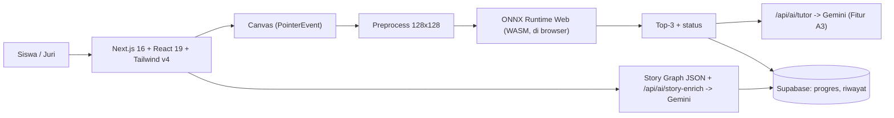

# MAIN CONTEXT — Aksantara × Bali DigiFest 2026 (AI Web Innovation Challenge)

> Dokumen ini adalah **sumber konteks utama** (pengganti `.agent/rules/00-project-context.md` dan `context/AKSANTARA-SSOT-v3.1.md` yang berorientasi JOINTS UGM). Jika ada konflik, dokumen ini yang berlaku untuk DigiFest.
> Rencana kerja ada di [MIGRASI_AKSANTARA_DIGIFEST.md](MIGRASI_AKSANTARA_DIGIFEST.md). Aturan lomba lengkap: [Panduan_Lomba_Bali_DigiFest_2026.md](Panduan_Lomba_Bali_DigiFest_2026.md).

---

## 1. Identitas

| Item | Nilai |
|---|---|
| Produk | **Aksantara** — pelatih menulis Aksara Bali berbasis AI |
| Tagline | *Tulis aksara Bali, dinilai AI, belajar lewat cerita.* |
| Kompetisi | Bali DigiFest 2026 — AI Web Innovation Challenge ("Build With AI, Solve For Bali") |
| Sub-tema utama | **Education & Smart Information Systems** (utama) + **Bali Smart Society** (budaya) |
| Kategori | Sesuaikan status tim: SMA/SMK atau Mahasiswa/Umum |
| Tim | Maks. 3 orang. Isi nama, peran, kontak ketua: `TODO` |
| Jadwal & kanal submit | **Belum diketahui**. Panduan menyatakan diumumkan panitia. Isi: `TODO` |
| Status | **Pre-existing project** (dibuat untuk Hackathon JOINTS UGM 2026). Wajib di-*disclose*. |

## 2. Masalah & Solusi

**Masalah.** Aksara Bali masih dipakai di papan nama, upacara, dan pelajaran muatan lokal Bahasa Bali, tetapi cara belajarnya didominasi buku cetak dan hafalan tanpa umpan balik atas tulisan tangan siswa. Aplikasi yang ada cenderung hanya transliterasi teks atau OCR pasif.

> `TODO (verifikasi sendiri)`: data pendukung (jumlah siswa, kebijakan muatan lokal, rujukan aturan daerah) harus dicari dari sumber resmi dan dikutip di proposal. **Jangan menulis angka atau nomor aturan dari ingatan.**

**Solusi.** Aplikasi web tempat siswa menulis aksara Bali di kanvas lalu AI mengklasifikasi bentuk akhirnya (tanpa penalti urutan goresan), memberi umpan balik, dan menautkannya ke kurikulum serta cerita rakyat Bali.

**Target pengguna.** Siswa SD–SMP/SMA yang belajar muatan lokal Bahasa Bali, guru, dan masyarakat umum yang ingin belajar aksara Bali.

## 3. Scope DigiFest (dikunci)

### ✅ Masuk scope (fokus penilaian)
1. **Latihan menulis Aksara Bali + klasifikasi AI** (inti produk).
2. **Katalog & kurikulum** karakter Aksara Bali yang didukung model.
3. **Tutor AI (LLM)**: penjelasan kesalahan berdasar hasil klasifikasi.
4. **Story Mode Bali** (*Calon Arang & Prabu Airlangga*) dengan tantangan menulis nyata.
5. **Riwayat progres siswa** yang nyata (Supabase).
6. **Pelestarian manuskrip** (transliterasi manual + review). Pendukung, bukan fitur AI.

### ⏸️ Dibekukan (disembunyikan dari UI publik, kode tetap di repo)
- Lontara & Sunda → tandai "eksperimen" atau sembunyikan. Alasan: tidak relevan dengan "Solve for Bali" dan dataset Lontara berlisensi CC BY-NC-ND.
- **Hardware / IoT** (Tactile Pad, Web Serial, RFID). Alasan: lomba menilai produk web yang bisa diuji juri dari jarak jauh, dan integrasinya belum berfungsi.
- Dashboard guru & profil dengan data mock, **sampai tersambung ke data nyata**.

### ❌ Tidak dikerjakan
- OCR/transliterasi AI untuk naskah (keputusan tim 16 Okt 2026).
- Ekspansi aksara baru, model bisnis B2G/BOS, produksi hardware.

## 4. Fitur AI (apa yang dihitung juri)

| # | Fitur | Teknologi | Status | Catatan |
|---|---|---|---|---|
| A1 | Klasifikasi karakter dari kanvas | EfficientNet-B0 → ONNX (30 kelas Bali) | 🟡 Berjalan via backend Python; **migrasi ke ONNX Runtime Web diputuskan** | Fitur utama. Klaim "di browser" baru boleh dipakai setelah migrasi + uji parity selesai. |
| A2 | Dialog narator Story Mode | Gemini API + fallback tetap | ✅ Berjalan | Tampilkan sumber (`gemini_ai` / `deterministic_lore`) secara jujur. |
| A3 | **Tutor kesalahan** (top-3 → penjelasan) | Gemini + deskripsi glif terkurasi | 🔲 Baru | Pembeda utama (Innovation 15%, AI 25%). |

**Alur AI utama:** `Canvas PNG → preprocessing kanonik (crop, grayscale 128×128, normalisasi ImageNet) → ONNX specialist Bali → top-3 + probabilitas → status (benar / perlu review) → (opsional) Tutor LLM → umpan balik`.

### Model Bali (fakta dari repo)
- Arsitektur EfficientNet-B0 pretrained ImageNet, FP32 ≈ 15,4 MiB, input `[1,3,128,128]`, output `logits`.
- **30 kelas**: 18 *wyajana* (ba, ca, da, ga, ha, ja, ka, la, ma, na, nga, nya, pa, ra, sa, ta, wa, ya) + 12 *swalalita* (ba kembang, calaca, damadu, gagora, jhajera, khakantia, narambat, phakapal, sasaga, sasapa, talatik, tatawa). **Belum ada sandangan/pangangge.**
- Macro-F1 99,37% pada **selection set, 167 sampel**, bukan frozen test dan bukan tulisan canvas nyata.
- Confidence rata-rata saat benar 0,996 vs saat salah 0,992 → **belum terkalibrasi**.
- Sumber data: Kaggle `wildanfatahh22/aksara-bali`, **lisensi "Unknown"**.
- Mapping Unicode **belum terverifikasi** (`unicode_sequence: null`).

## 5. Aturan Klaim (anti-diskualifikasi)

Panduan hal. 10: pemalsuan demo atau klaim yang menyesatkan = pelanggaran material.

| ❌ Jangan klaim | ✅ Boleh klaim |
|---|---|
| "Akurasi 99%" tanpa konteks | "Macro-F1 99,37% pada selection set 167 sampel; evaluasi tulisan canvas: `<angka hasil uji>`" |
| "Jalan di browser / data tidak keluar perangkat" | Hanya jika inferensi sudah dipindah ke ONNX Runtime Web dan diverifikasi |
| "<50 ms" | Angka hasil ukur nyata end-to-end (sebut kondisi perangkatnya) |
| "AI menilai kualitas tulisan" | "AI mengklasifikasi bentuk karakter; skor = probabilitas, bukan nilai kualitas" |
| Skor/catatan AI statis di halaman hasil | Hanya hasil nyata dari sesi pengguna |
| "Memverifikasi posisi diakritik / stroke order" | Tidak didukung model |

**Data mock di UI wajib dihapus atau diberi label jelas "contoh data"** sebelum submit.

## 6. Arsitektur

Tech stack: Next.js 16 (App Router), React 19, Tailwind CSS v4, Supabase (auth + PostgreSQL), ONNX Runtime (CPU Python sekarang; Web target), FastAPI, Gemini API, hosting `TODO` (Vercel untuk web; backend AI `TODO` jika tetap dipakai).

## 7. Peta repo (yang relevan)

| Path | Fungsi |
|---|---|
| `web/src/lib/onnx/onnx-classifier.ts` | `evaluateGlyph()` — adapter frontend |
| `web/src/app/api/ai/classify/route.ts` | Proxy ke backend klasifikasi |
| `web/src/app/api/ai/story-enrich/route.ts` | Dialog narator Gemini |
| `ai/deployment/server.py`, `runtime.py` | FastAPI + ONNX Runtime CPU |
| `ai/deployment/models/bali/` | `model.onnx`, `labels.json`, `manifest.json`, `evaluation.json` |
| `ai/preprocess.py`, `ai/harness/preprocess.js` | Preprocessing Python dan porting JS |
| `shared/aksara-classifier.json` | Pemetaan slug kurikulum → label model |
| `web/src/lib/supabase/progress-service.ts` | Penyimpan progres (**belum dipakai**) |
| `web/src/app/(siswa)/latihan/web/hasil/page.tsx` | Halaman hasil (**mock**) |
| `supabase/schema.sql` | Skema DB |

## 8. Kepatuhan, Lisensi & Disclosure

- **Pre-existing:** tag baseline `pre-digifest-baseline` di commit `52dc81d`. Semua pekerjaan setelahnya dihitung "dikembangkan untuk DigiFest".
- **Dataset Bali:** lisensi tidak diketahui → tulis jujur di disclosure, minta izin ke pemilik, dan/atau lengkapi dengan data tulisan milik sendiri (dengan consent).
- **Dataset Lontara (CC BY-NC-ND) & Sunda:** jangan ikut dipublikasikan bobotnya di deployment DigiFest.
- **AI coding assistant:** wajib diungkapkan (nama tool apa pun yang dipakai: `TODO`).
- **Third-party:** NusaAksara (rujukan akademis), Google Noto Sans Balinese, ImageNet pretrained, Kaggle dataset, Gemini API, library OSS (`package.json`).
- **Secret:** tidak boleh ada API key di repo publik. Hanya `.env.example`. **Periksa riwayat git** untuk kebocoran sebelum repo dibuka.
- **Privasi:** jelaskan data apa yang dikirim ke model (gambar kanvas ke backend; teks konteks ke Gemini), dan bagaimana dijaga.
- **Tutor AI:** beri disclaimer bahwa umpan balik bersifat bantuan belajar, bukan penilaian resmi.

## 9. Kriteria Penilaian → Prioritas

| Kriteria Tahap 1 | Bobot | Aksantara harus menunjukkan |
|---|---:|---|
| AI Relevance & Implementation | 25% | A1 + A3, penjelasan input-output, alasan AI diperlukan, batas model |
| Problem Relevance & Impact | 20% | Masalah aksara Bali + data sumber resmi |
| MVP Functionality | 20% | Alur utama bisa dicoba juri tanpa instalasi, tanpa mock |
| Innovation & Differentiation | 15% | No stroke-order penalty, tutor kesalahan, cerita Bali |
| Technical Feasibility & Repo | 15% | README template, arsitektur, repo bersih, `.env.example` |
| Compliance & Documentation | 5% | Disclosure jujur, format PDF, tag versi |

## 10. Definition of Done (Tahap 1)

- [ ] Juri dapat membuka URL → login/akun demo → menulis aksara Bali → mendapat hasil AI nyata.
- [ ] Tidak ada skor, profil, atau dashboard palsu yang tampil tanpa label.
- [ ] AI berjalan tanpa bergantung laptop pribadi (browser WASM atau backend ter-host stabil).
- [ ] Tutor AI (A3) berfungsi, dengan fallback bila API gagal (dan UI menyebut sumbernya).
- [ ] Evaluasi tulisan canvas nyata dilaporkan dengan angka jujur.
- [ ] README sesuai Lampiran B panduan; Disclosure sesuai Lampiran C; Proposal ≤ 5 halaman isi.
- [ ] Tag `v1.0-submission` dan commit hash tercatat; kuota API aman selama penjurian.

## 11. Pertanyaan Terbuka

| # | Pertanyaan | Dampak |
|---|---|---|
| 1 | Kategori tim: SMA/SMK atau Mahasiswa/Umum? Anggota siapa saja? | Pendaftaran |
| 2 | Jadwal dan kanal submit resmi? | Timeline |
| 3 | ~~Browser atau backend?~~ **Diputuskan: ONNX Runtime Web (browser).** Backend FastAPI hanya untuk dev/benchmark. | Selesai |
| 4 | Apakah pemilik dataset Bali bisa dihubungi? | Lisensi |
| 5 | Apakah 18+12 kelas cukup untuk kurikulum yang diklaim? Adakah slug Bali di `shared/aksara-classifier.json` yang belum punya model? | Cakupan kurikulum |
| 6 | Sudah ada kunci Gemini dengan kuota memadai? | Fitur A2/A3 |

