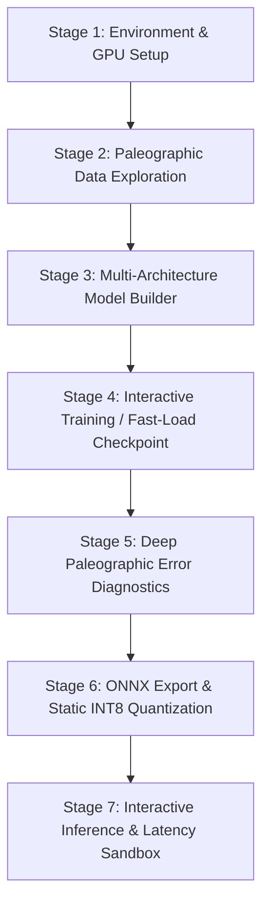

# Plan: 4 Modular Interactive Classifier Notebooks & Architecture Exploration
**Aksantara (JOINTS UGM 2026 — Theme: Education)**

## 1. Context & Objectives

Eksperimen awal pada `CLASSIFIER_AKSANTARA_PLAN.md` telah berhasil menyelesaikan 7 perlakuan pelatihan secara berurutan dan mengunci 4 checkpoint pemenang (`best.pt`) pada Google Drive:
- **Sunda:** `sunda/ordinary/attempt-0001/best.pt` (30 kelas, Macro-F1 95.44%)
- **Lontara:** `lontara/weighted/attempt-0002/best.pt` (114 kelas, Macro-F1 47.47%)
- **Bali:** `bali/weighted/attempt-0001/best.pt` (30 kelas, Macro-F1 87.06%)
- **Combined:** `combined/ordinary/attempt-0003/best.pt` (174 kelas, Macro-F1 59.21%)

### Masalah pada Desain Awal
Notebook eksekusi sebelumnya dirancang sebagai background worker (`ai.colab_experiments`) untuk menghindari lag renderer browser Zen dan close WebSocket pada transport berkapasitas besar. Desain ini efektif untuk komputasi headless berjam-jam, namun memiliki kelemahan signifikan bagi evaluasi manusia:
1. **Black Box bagi Penguji/Juri:** Pihak ketiga tidak dapat melihat interaksi langsung, visualisasi grafik training, kurva konvergensi per epoch, dan sampel citra per aksara.
2. **Ketiadaan Diagnostik Paleografi Visual:** Tidak ada galeri visual untuk *misclassified glyphs* (mengetahui aksara mana yang keliru diprediksi dan mengapa model bingung).
3. **Monolitik:** Keempat target digabung dalam satu pipeline otomatis alih-alih memberikan kontrol mandiri per aksara.

### Sasaran Plan Ini
Membangun **4 notebook interaktif terpisah** di `ai/notebooks/` yang modular, mandiri, kaya visualisasi, dan mendukung eksplorasi multi-arsitektur (from-scratch vs pretrained seperti ResNet, MobileNet, EfficientNet, hingga YOLO classification) dengan tetap mematuhi batasan *Performance Budget* Aksantara (Rule 05: model WASM $\le 15$ MB, latensi $< 50$ ms).

---

## 2. Struktur 4 Notebook Modular

```text
ai/notebooks/
├── 01_sunda_classifier.ipynb       # 30 Kelas Ngalagena & Rarangken
├── 02_lontara_classifier.ipynb     # 114 Kelas Geometris & Sudut Tajam (Imbalanced)
├── 03_bali_classifier.ipynb        # 30 Kelas Kurvalinier & Gantungan/Adeg-adeg
└── 04_combined_174_classifier.ipynb# 174 Kelas Script-Unknown & Analisis Cross-Script
```

Setiap notebook mengadopsi **Universal 7-Stage Interactive Flow**:



---

## 3. Spektrum Eksplorasi Arsitektur (Multi-Architecture Spectrum)

Untuk memenuhi kebutuhan laporan teknis dan presentasi juri JOINTS UGM 2026, setiap notebook menyediakan perbandingan komparatif arsitektur:

| Kategori | Arsitektur | Pretraining | Parameter | Ukuran FP32 | Karakteristik & Nilai Riset |
|---|---|---|---|---|---|
| **From Scratch** | `Custom-CNN-4Layer` | None | ~1.2M | ~4.8 MB | Baseline murni tanpa pengaruh fitur ImageNet; menguji kapasitas representasi geometris aksara secara independen. |
| **From Scratch** | `MobileNetV3-Scratch` | None | ~1.5M | ~6.0 MB | Kontrol ablasi: mengukur seberapa besar kontribusi transfer learning ImageNet terhadap akurasi aksara daerah. |
| **Lightweight Pretrained** | `MobileNetV3-Small` *(Default SSOT)* | ImageNet-1k | ~1.5M | ~6.1 MB | Standar produksi Aksantara: latensi ultra-cepat (<10ms WASM), ukuran kecil (~2.5 MB INT8), ideal untuk Web Canvas. |
| **Standard Deep CNN** | `ResNet-18` | ImageNet-1k | ~11.2M | ~44.8 MB | Residual connections klasik; tolok ukur batas atas kapasitas konvolusional dalam menahan degradasi gradien. |
| **Efficient Scaling** | `EfficientNet-B0` | ImageNet-1k | ~4.0M | ~16.0 MB | Compound scaling (depth, width, resolution); efisiensi parameter tinggi. |
| **YOLO Classification** | `YOLOv8n-cls` | ImageNet-1k | ~1.4M | ~5.8 MB | Ekplorasi arsitektur backbone CSPDarknet + C2f untuk klasifikasi karakter isolasi 128×128. |

> **Catatan Teknis YOLO:** Dataset Aksantara adalah citra karakter terpotong tunggal (*isolated single glyph* 128×128), bukan multi-object detection frame foto. Oleh karena itu, arsitektur YOLO yang relevan dan kompatibel adalah **YOLOv8 Classification mode (`yolov8n-cls`)**, bukan object detection (`yolov8n-detect`).

---

## 4. Rincian Teknis per Tahapan Notebook

### Stage 1: Environment, Mount & Reproducibility
- Deteksi hardware GPU (`torch.cuda.is_available()`, device name: T4/L4).
- Pengecekan Google Drive mount interaktif.
- Download / verifikasi dataset lokal tanpa duplikasi.
- Pengecekan seed deterministik (default: 42).

### Stage 2: Eksplorasi Data Paleografi (Visual EDA)
- **Grid Galeri Karakter:** Menampilkan matriks 5×6 sampel aksara asli dengan nama kelas, font referensi Unicode, dan fonetiknya.
- **Histogram Distribusi:** Grafik batang jumlah sampel per kelas pada partisi Train/Selection/Calibration/Test untuk memperlihatkan rasio ketimpangan (contoh: Lontara 4.39× vs Sunda 1.02×).
- **Inspeksi Binarisasi & Kontur:** Visualisasi citra setelah canonical grayscale & bounding-box recrop.

### Stage 3: Modular Model Builder
- Dropdown / variabel pemilihan arsitektur (`MODEL_NAME = "mobile" | "resnet18" | "cnn" | "efficientnet" | "yolo"`).
- Inisialisasi head klasifikasi sesuai jumlah kelas target (30 untuk Sunda/Bali, 114 untuk Lontara, 174 untuk Combined).
- Tabel ringkasan arsitektur: Total Parameters, Trainable Parameters, Estimated FLOPs, Estimated Memory.

### Stage 4: Turnamen Training dengan Early Stopping
- Keempat notebook memakai maksimum **50 epoch** per kandidat dan **patience 7**, berdasarkan **selection Macro-F1**. Skor yang sama tidak mereset patience.
- Semua kandidat dibangun ulang dengan seed 42 dan konfigurasi pretraining masing-masing; checkpoint MobileNet historis tidak dimuat dan tidak ikut leaderboard.
- Setiap peningkatan selection Macro-F1 menyimpan `best.pt` beserta arsitektur, urutan label, seed, epoch, dan skor. Riwayat loss/F1 aktual disimpan ke `history.json` setiap epoch; tidak ada kurva sintetis.
- Checkpoint terbaik dipulihkan sebelum evaluasi akhir, pemilihan champion, dan ekspor ONNX.
- Setiap eksekusi Stage 4 membuat direktori run baru: `aksantara-runs/tournaments/<script>/<run_id>/<architecture>/` di Drive pada Colab, atau `ai/runs/tournaments/<script>/<run_id>/<architecture>/` secara lokal.
- Ringkasan Stage 7 mencatat protokol training, jumlah epoch aktual, epoch terbaik, dan lokasi checkpoint. Partisi test tidak dipakai untuk pemilihan model.
- Hasil turnamen lama dengan training empat epoch tetap historis; peringkat baru membutuhkan eksekusi ulang Stage 4–7.
- Stage 5 notebook menampilkan leaderboard/kurva dari run aktif. Pada Combined, tabel spesialis vs universal memakai Macro-F1 dari prediksi champion pada selection yang dikelompokkan menurut ground-truth aksara, dengan salah lintas aksara tetap dihitung salah; tidak ada angka estimasi hardcoded.
- Skor spesialis berasal dari ringkasan ekspor bertimestamp terbaru yang tersedia di Drive atau `ai/runs`, disertai path sumber dan metadata training. Ringkasan yang hilang ditandai tidak tersedia. Perbandingan bersifat deskriptif: kesamaan split/preprocessing dan protokol training antar-run belum terbukti, khususnya ringkasan Sunda lama tanpa metadata training.
- Setiap notebook menyediakan sel akhir **Refresh Perbandingan Tersimpan — Tanpa Training**, mandiri dari state Stage 1–7. Sel memakai stdlib, meminta mount Drive hanya bila perlu, lalu membaca ringkasan terbaru dan `selection_by_script` Combined. Tidak memuat model atau mengulang training; ringkasan/data yang tidak tersedia dilaporkan sebagai error, bukan skor palsu.
- Stage 7 Combined menyimpan `selection_by_script` untuk refresh berikutnya. Ringkasan Combined lama sudah diperkaya melalui inferensi ONNX tersimpan pada selection dengan urutan label checkpoint; Macro-F1 keseluruhan terverifikasi sama dengan run tersimpan.

### Stage 5: Deep Paleographic Error Diagnostics (Visual Analysis)
- **Heatmap Confusion Matrix Interaktif:** Matriks normalisasi per kelas menggunakan Seaborn/Matplotlib resolusi tinggi.
- **Tabel Metrik Per-Kelas:** Precision, Recall, F1-Score, dan Support untuk mengidentifikasi kelas yang paling sering salah dipelajari.
- **Galeri Visual *Top Misclassified Glyphs*:** Menampilkan 12 sampel aksara yang paling sering salah diklasifikasikan oleh model, lengkap dengan *Ground Truth* vs *Predicted Label* beserta nilai probabilitas kepercayaan (*confidence*). Ini sangat penting untuk kurasi paleografi dan demo hackathon.

### Stage 6: ONNX Export & INT8 Quantization
- Cell ekspor PyTorch $\rightarrow$ ONNX Opset 17 (`<script>-classifier.onnx`).
- Uji numerik *bit-parity* antara PyTorch tensor dan ONNX Runtime CPU pada seluruh partisi seleksi (toleransi error $\le 10^{-4}$ dan kecocokan Top-1 $\ge 99.9\%$).
- Kuantisasi statis INT8 QDQ (`int8/<script>-classifier.onnx`) menggunakan sampel kalibrasi partisi training.
- Komparasi ukuran: FP32 MB vs INT8 MB (target: $\le 15$ MB).
- Implementasi notebook menggabungkan ekspor, kuantisasi, dan sandbox di Stage 7. Di Colab, Stage 7 memasang `onnx`/`onnxruntime` yang belum tersedia dan memuat ulang visualizer agar benchmark tidak memakai status import opsional lama (`ort=None`); tidak membutuhkan restart atau training ulang.
- Gate notebook Stage 7 memakai seluruh selection partition nyata, bukan noise acak: output finite dan bentuk identik, selisih logit absolut `<0.05`, serta Top-1 cocok 100%. Batas absolut notebook tidak diubah; ini belum membuktikan target release `1e-4` di atas atau parity browser/WASM.

### Stage 7: In-Notebook Inference & Latency Sandbox
- Widget interaktif untuk menguji inferensi satu citra (baik dari dataset maupun goresan simulasi).
- Benchmark latensi inferensi ONNX Runtime CPU/WASM (100 run warm-up + 100 run benchmark, mencatat p50 dan p95 dalam ms).
- Tampilan Top-5 bar chart probabilitas hasil prediksi.

---

## 5. Rincian Khusus per Notebook

### Notebook 1: `01_sunda_classifier.ipynb`
- **Fokus Paleografi:** 30 kelas aksara Sunda (*Ngalagena* konsonan dasar modular dan *Rarangken* diakritik atas/bawah/samping).
- **Karakteristik Data:** Rasio kelas seimbang (1.0244, 41..42 train sample per kelas).
- **Highlight Analisis:** Evaluasi apakah model mampu membedakan konsonan dasar yang mirip dan bagaimana letak rarangken mempengaruhi prediksi.

### Notebook 2: `02_lontara_classifier.ipynb`
- **Fokus Paleografi:** 114 kelas aksara Lontara (Bugis-Makassar) dengan karakteristik sudut tajam dan bentuk geometris dominan.
- **Karakteristik Data:** Rasio ketimpangan tinggi (4.3889, 18..79 train sample per kelas).
- **Highlight Analisis:** Analisis efektivitas *Loss Weighting* pada kelas minoritas; visualisasi kelas minoritas yang mengalami *zero recall* vs *improved recall*.

### Notebook 3: `03_bali_classifier.ipynb`
- **Fokus Paleografi:** 30 kelas aksara Bali dengan kontur kurvalinier dinamis, ligatur, dan gantungan (*adeg-adeg*).
- **Karakteristik Data:** Rasio ketimpangan sedang (1.6452, 31..51 train sample per kelas).
- **Highlight Analisis:** Evaluasi kurva lengkung dan pemisahan ligatur kompleks.

### Notebook 4: `04_combined_174_classifier.ipynb`
- **Fokus Paleografi:** 174 kelas gabungan Trinitas Aksara Nusantara tanpa petunjuk aksara (*script-unknown 174-way classification*).
- **Karakteristik Data:** 9.406 sampel train, 1.337 selection, 678 calibration, 2.021 test.
- **Highlight Analisis:**
  - **Cross-Script Confusion 3×3:** Analisis probabilitas kebingungan lintas aksara (apakah Lontara disangka Sunda atau Bali?).
  - **Perbandingan Head-to-Head:** Grafik komparasi performa 3 Spesialis (*script-known routing*) vs 1 Gabungan (*script-unknown*).
  - Pembuktian bahwa model gabungan memiliki representasi universal yang tangguh dengan selisih performa tipis (~3.3%).

---

## 6. Helper Module: `ai/notebook_visualizer.py`

Untuk menjaga notebook tetap rapi dan tidak dipenuhi ratusan baris kode plotting/boilerplate, seluruh logika presentasi visual ditempatkan di modul helper `ai/notebook_visualizer.py`:
- `plot_glyph_grid(dataset, labels, num_samples=30)`: Plot galeri aksara beranotasi.
- `plot_class_distribution(dataset, labels)`: Plot histogram frekuensi kelas.
- `plot_training_curves(history)`: Plot kurva loss & macro-F1 interaktif.
- `plot_confusion_matrix(cm, labels, title="Confusion Matrix")`: Plot heatmap confusion matrix resolusi tinggi.
- `plot_misclassified_gallery(model_or_session, dataset, labels, top_k=12)`: Plot galeri aksara yang salah diprediksi.
- `benchmark_latency(session, input_shape=(1, 3, 128, 128), n_runs=100)`: Eksekusi benchmark latensi mikrodetik.

---

## 7. Rencana Kerja Bertahap (Roadmap Eksekusi)

| Fase | Target Deliverable | Kriteria Selesai (Definition of Done) |
|---|---|---|
| **Fase 1** | **Ekspor 4 Checkpoint ke ONNX (Tugas 1)** | 4 file `.onnx` (FP32 & INT8) terverifikasi parity dan tersimpan di Google Drive serta `ai/runs/four-models-onnx/`. |
| **Fase 2** | **Implementasi `ai/notebook_visualizer.py` & Multi-Model Factory** | Modul plotting helper dan model builder (CNN scratch, MobileNet, ResNet-18) lulus unit test lokal. |
| **Fase 3** | **Pembuatan 3 Notebook Spesialis (`01_sunda`, `02_lontara`, `03_bali`)** | Masing-masing notebook berisi alur 7-stage lengkap, visualisasi data, load existing checkpoint, evaluasi error visual, dan ekspor ONNX. |
| **Fase 4** | **Pembuatan Notebook Gabungan (`04_combined_174`)** | Notebook gabungan memuat cross-script confusion 3x3 dan komparasi spesialis vs gabungan. |
| **Fase 5** | **Verifikasi Interaktif & Dokumentasi** | Keempat notebook dapat dijalankan end-to-end di Colab tanpa crash dan menghasilkan visualisasi siap pakai untuk presentasi juri. |
