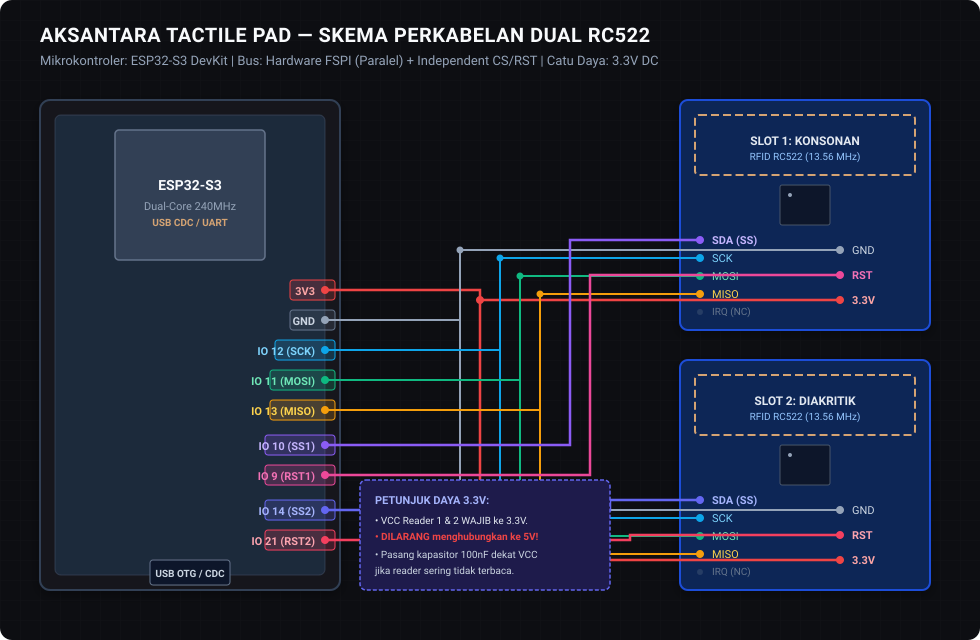

# Skema Perkabelan Aksantara Tactile Pad: ESP32-S3 Dual RC522

Dokumen ini merupakan panduan resmi perkabelan perangkat keras (*hardware wiring guide*) untuk konsol fisik **Aksantara Tactile Pad** menggunakan mikrokontroler **ESP32-S3** (Espressif Systems) dan **2x Modul RFID RC522 (13.56 MHz)**.




> **Diagram Visual:** Lihat berkas gambar vektor resolusi tinggi [`iot/docs/wiring_diagram.svg`](./wiring_diagram.svg) untuk panduan warna kabel DuPont pin-to-pin.
---

## 1. Prinsip Arsitektur Bus SPI Paralel (Shared SPI Bus)

Perangkat ini membaca dua slot fisik secara independen:
1. **Slot 1 (Kiri):** Slot Konsonan Dasar (*Ngalagena / Wianjana / Lontara Consonant*).
2. **Slot 2 (Kanan):** Slot Diakritik / Vokalisasi (*Rarangken / Pangangge / Tanda Vokal*).

Kedua modul RC522 berbagi jalur bus SPI utama (**SCK, MOSI, MISO**) secara paralel pada kontroler FSPI ESP32-S3, sementara jalur **Slave Select (SDA/SS)** dan **Reset (RST)** dikendalikan oleh pin GPIO terpisah untuk mencegah *bus contention*.

```
                      +-------------------+
                      |   ESP32-S3 Dev    |
                      |  (USB CDC / UART) |
                      +---------+---------+
                                |
         +----------------------+----------------------+
         | SHARED SPI BUS                              |
         | (SCK: GPIO 12, MOSI: GPIO 11, MISO: GPIO 13)|
         | POWER: 3.3V & GND                           |
         +----------------------+----------------------+
                                |
               +----------------+----------------+
               |                                 |
     +---------v---------+             +---------v---------+
     |  RC522 READER 1   |             |  RC522 READER 2   |
     |  (Slot Konsonan)  |             |  (Slot Diakritik) |
     +-------------------+             +-------------------+
     | SS : GPIO 10      |             | SS : GPIO 14      |
     | RST: GPIO 9       |             | RST: GPIO 21      |
     +-------------------+             +-------------------+
```

---

## 2. Matriks Koneksi Pin Lengkap (Pinout Matrix)

| Pin RC522 | Fungsi Sinyal | Reader 1 (Slot Konsonan) | Reader 2 (Slot Diakritik) | Catatan Penting |
| :--- | :--- | :--- | :--- | :--- |
| **VCC** | Catu Daya 3.3V | **Pin 3V3** | **Pin 3V3** | **PERINGATAN KERAS:** Wajib 3.3V! RC522 **TIDAK toleran 5V**. Tegangan 5V akan membakar chip MFRC522. |
| **RST** | Reset Hardware | **GPIO 9** | **GPIO 21** | Jalur reset independen per reader |
| **GND** | Ground Sirkuit | **Pin GND** | **Pin GND** | Common ground dengan ESP32-S3 |
| **IRQ** | Interrupt Request | *NC (Not Connected)* | *NC (Not Connected)* | Dikosongkan; firmware memakai metode polling non-blocking |
| **MISO** | Master In Slave Out | **GPIO 13** | **GPIO 13** | Jalur bersama (Paralel) |
| **MOSI** | Master Out Slave In | **GPIO 11** | **GPIO 11** | Jalur bersama (Paralel) |
| **SCK** | SPI Serial Clock | **GPIO 12** | **GPIO 12** | Jalur bersama (Paralel) |
| **SDA / SS** | Slave Select (CS) | **GPIO 10** | **GPIO 14** | Jalur kontrol aktif rendah (*active-low*) terpisah |

---

## 3. Catatan Khusus Silikon & GPIO ESP32-S3

### A. Larangan Keras Pin Terlarang (Reserved Pins)
- **GPIO 26 sampai GPIO 37 DILARANG DIGUNAKAN.** Pada silikon ESP32-S3 (termasuk ESP32-S3-WROOM-1 / WROOM-2), pin GPIO 26–37 terhubung secara internal ke chip **SPI Flash** dan **Octal PSRAM**. Menggunakan pin ini untuk periferal eksternal akan menyebabkan mikrokontroler mengalami *Core Panic*, *Boot Loop*, atau kegagalan baca flash permanen.

### B. Pemilihan Port USB (Native USB CDC vs UART)
Board ESP32-S3 DevKit umumnya memiliki **2 port USB Type-C**:
1. **Port "USB" (Native USB OTG - GPIO 19 & 20):**
   - Terhubung langsung ke silikon ESP32-S3 USB Serial JTAG controller.
   - Untuk menggunakannya pada Web Serial API, opsi `USB CDC On Boot: Enabled` **wajib aktif** saat kompilasi firmware.
2. **Port "COM / UART" (Chip USB-to-UART Bridge seperti CH340 / CP2102):**
   - Terhubung ke hardware UART0 (GPIO 43 TX / GPIO 44 RX).
   - Menghasilkan port serial standar tanpa memerlukan konfigurasi khusus pada CDC bootloader.

> **Rekomendasi Aksantara:** Kedua port didukung penuh pada baud rate **115200**. Jika menggunakan port native "USB", pastikan flag `-D ARDUINO_USB_CDC_ON_BOOT=1` telah didefinisikan.

### C. Pin Status LED / Visual Indikator
- **GPIO 48:** Pin data default untuk built-in Addressable WS2812 RGB NeoPixel pada board ESP32-S3-DevKitC-1.
- **GPIO 2:** Alternatif pin untuk Single-Color LED status.

---

## 4. Skematik Detail Sambungan Fisik

```
   ESP32-S3 DevKit                      Modul RC522 Reader 1 (Konsonan)
   +--------------------+               +------------------+
   |                3V3 +---------------+ 3.3V             |
   |                GND +---------------+ GND              |
   |            GPIO 12 +---------------+ SCK              |
   |            GPIO 11 +---------------+ MOSI             |
   |            GPIO 13 +---------------+ MISO             |
   |            GPIO 10 +---------------+ SDA (SS)         |
   |             GPIO 9 +---------------+ RST              |
   |                    |               | IRQ (NC)         |
   |                    |               +------------------+
   |                    |
   |                    |               Modul RC522 Reader 2 (Diakritik)
   |                    |               +------------------+
   |                    +---------------+ 3.3V (Paralel)   |
   |                    +---------------+ GND  (Paralel)   |
   |                    +---------------+ SCK  (Paralel)   |
   |                    +---------------+ MOSI (Paralel)   |
   |                    +---------------+ MISO (Paralel)   |
   |            GPIO 14 +---------------+ SDA (SS)         |
   |            GPIO 21 +---------------+ RST              |
   +--------------------+               | IRQ (NC)         |
                                        +------------------+
```

---

## 5. Pertimbangan Integritas Sinyal & Stabilitas Daya

1. **Kapasitor Decoupling (Peredam Ripple):**
   - Saat pemancar RF 13.56 MHz pada chip RC522 aktif (*antenna field burst*), lonjakan arus instan mencapai 26–30 mA per modul.
   - Jika modul gagal membaca kartu secara konsisten (muncul pesan `PCD_DumpVersionToSerial` nilai `0x00` atau `0xFF`), pasang **kapasitor elektrolit 10µF** dan **kapasitor keramik 100nF** secara paralel di antara pin **3.3V dan GND** sedekat mungkin dengan masing-masing modul RC522.
2. **Panjang Kabel Jumper SPI:**
   - Karena bus SPI beroperasi pada frekuensi 4 MHz, gunakan kabel jumper pendek ($\le 15\text{ cm}$) berkualiatas baik.
   - Hindari melilit kabel SCK dengan kabel data lainnya untuk mencegah *crosstalk*.
3. **Pemisahan Jarak Fisik Antena RC522:**
   - Letakkan Modul 1 dan Modul 2 dengan jarak antar-antena PCB minimal **6–8 cm**.
   - Jarak yang terlalu dekat ($< 4\text{ cm}$) dapat menimbulkan interferensi medan magnet (*inductive cross-coupling*) yang memperlemah sensitivitas pembacaan kartu.
